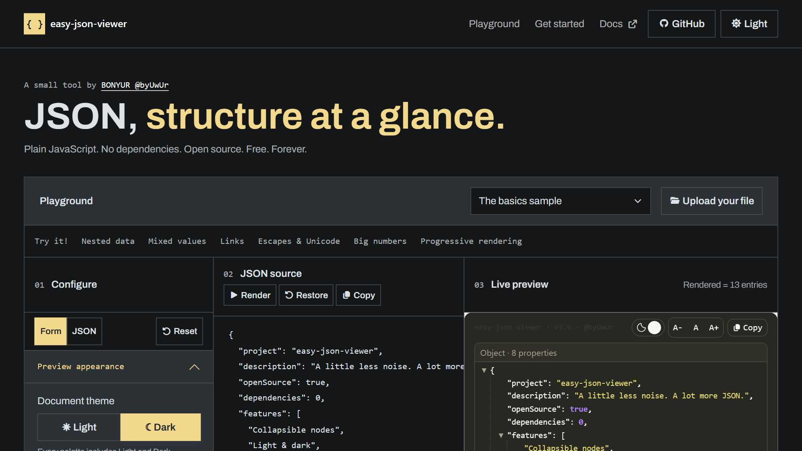

# byuwur/easy-json-viewer



**JSON, structure at a glance.**

Turn JavaScript values into a collapsible tree.

Use it for API responses, configuration, debugging panels, and large nested payloads.

One JavaScript file. One scoped stylesheet. No build step. Plain JavaScript, with no runtime dependencies.

[Open the playground](https://byuwur.github.io/easy-json-viewer/) · [CodePen](https://codepen.io/byuwur/pen/ExBeOPR)

Open `index.html` for the local playground; its page assets require internet access.

## Installation

**Recommended: CDN.** No downloads or package manager.

```html
<link href="https://cdn.jsdelivr.net/gh/byuwur/easy-json-viewer@latest/json.css" rel="stylesheet" />
<script src="https://cdn.jsdelivr.net/gh/byuwur/easy-json-viewer@latest/json.js" defer></script>
```

The CDN example uses `@latest` and requires internet access. Use a published tag or commit to pin a version.

**Local files:** For offline use, save `json.js` and `json.css` beside your HTML:

```html
<link href="json.css" rel="stylesheet" />
<script src="json.js" defer></script>
```

## Usage

```html
<pre id="byJSONrenderer" data-theme="light"></pre>
<script>
  document.addEventListener("DOMContentLoaded", () => {
    const data = { name: "John Dough", projects: ["easy-json-viewer"], active: true };
    byJSONviewer(document.getElementById("byJSONrenderer"), data, { collapsed: true });
  });
</script>
```

Pass a JavaScript value: object, array, string, number, boolean, `null`, `bigint`, or a compatible big-number object. Parse JSON text with `JSON.parse()` first.

`byJSONviewer(element, value, options?)` replaces the target's contents and returns `undefined`. An invalid target throws `TypeError`. It has no `ready` promise or `destroy()` controller; rendering another value on the same target cancels its pending chunks.

Use acyclic, JSON-shaped data. Only own enumerable object properties are shown; functions, symbols, and `undefined` display as `null`. Non-finite numbers also display as `null`. Dates, Maps, Sets, and custom class instances have no special rendering support. Keep the supplied value stable while its chunks render; the viewer does not clone it.

Exported HTML starters use default settings, independently of playground changes.

## Options

Pass options as the third argument:

| Option             | Default     | Meaning                                                                     |
| ------------------ | ----------- | --------------------------------------------------------------------------- |
| `collapsible`      | `true`      | Show disclosure controls; false keeps every node expanded.                  |
| `collapsed`        | `false`     | Collapse nodes initially.                                                   |
| `rootCollapsible`  | `true`      | Allow the root object/array to collapse.                                    |
| `withQuotes`       | `true`      | Quote object keys.                                                          |
| `withLinks`        | `true`      | Link `http`, `https`, `ftp`, and `ftps` URLs.                               |
| `bigNumbers`       | `false`     | Use compatible big-number objects' string representation.                   |
| `forceMonospace`   | `false`     | Force a system monospace font when the target is not a `<pre>`.             |
| `chunkSize`        | `1000`      | Elements per chunk; invalid/nonpositive values use the default.             |
| `chunkLatency`     | `25`        | Milliseconds between chunks; invalid/negative values use the default.       |
| `toolbar`          | `true`      | Show the viewer header; secondary tools are configured separately.          |
| `credits`          | `true`      | Show attribution in the header.                                             |
| `themeToggle`      | `true`      | Show the theme toggle.                                                      |
| `fontSizeControls` | `true`      | Show text-size controls.                                                    |
| `copyButton`       | `true`      | Show a button to copy the complete JSON, including collapsed/pending nodes. |
| `controlsSize`     | `"regular"` | `"small"`, `"regular"`, or `"large"`; invalid values use `"regular"`.       |
| `controlsCompact`  | `true`      | Keep credits beside controls; `false` stacks them. Wraps as needed.         |
| `controlsPosition` | `"top"`     | Sticky `"top"` or `"bottom"` toolbar; invalid values use `"top"`.           |

Smaller chunks improve responsiveness; lower latency starts the next chunk sooner. Re-rendering a target cancels its pending chunks.

Chunking spreads DOM creation across timers; it does not virtualize or limit the input. Collapsed descendants still render. Bound payload size and depth in the calling application.

Copy serializes the supplied value as two-space-indented JSON, independently of which chunks are visible. Unsupported values follow `JSON.stringify()` semantics and can differ from the displayed `null` fallback. BigInt and compatible big-number values become decimal strings to preserve precision. Copy requires clipboard permission in a secure context.

Read the library version with `byJSONviewer.VERSION`.

Controls stick to the selected edge of the page or nearest scrolling container.

Use `toolbar: false` to hide the header, or disable `credits`, `themeToggle`, `fontSizeControls`, and `copyButton` individually.

Controls use monospace by default; override `--by-view-controls-font` to change it.

## Themes

`json.css` includes all palettes in Light and Dark. Monokai is the default.

| Palette           | `data-theme`    | What it looks like                                                |
| ----------------- | --------------- | ----------------------------------------------------------------- |
| Monokai (default) | `monokai`       | Warm light and dark colors.                                       |
| GitHub            | `github`        | Familiar neutral surfaces and syntax colors.                      |
| Solarized         | `solarized`     | Warm light or deep blue-green dark surfaces.                      |
| High Contrast     | `high-contrast` | Black/white surfaces, strong text, borders, and focus indicators. |

Use a mode class and a palette name together:

```html
<div id="viewer" class="dark" data-theme="github"></div>
<!-- High Contrast Light: class="light" data-theme="high-contrast" -->
<!-- High Contrast Dark: class="dark" data-theme="high-contrast" -->
```

Rendering adds `.byJSONdocument`; its variables affect only that container and its children. The theme switch changes mode while keeping the palette; re-rendering preserves both. A named palette without a mode class starts in Light; if both mode classes are present, Dark wins.

`data-theme="light"` and `data-theme="dark"` select Monokai and override mode classes. A mode class alone, or no explicit theme, also uses Monokai.

### High Contrast

High Contrast text colors target at least [7:1 contrast](https://www.w3.org/WAI/WCAG22/Understanding/contrast-enhanced.html), with [3:1 contrast for control boundaries and focus cues](https://www.w3.org/WAI/WCAG22/Understanding/non-text-contrast.html). Check contrast again when you override colors.

### Make it yours

The playground's **Custom theme CSS** field edits both modes of the selected palette. Export those rules to your own stylesheet and use `data-theme="custom"` with `class="light"` or `class="dark"`. Custom drafts stay in the playground; the renderer does not store them.

Define a named palette after the viewer stylesheet. Unspecified colors inherit Monokai:

```css
.byJSONdocument.light[data-theme="ocean"] {
  --by-view-bg: #f3f8fc;
  --by-json-text: #102a43;
  --by-json-border: #486581;
  --by-json-string: #005a9c;
}

.byJSONdocument.dark[data-theme="ocean"] {
  --by-view-bg: #102a43;
  --by-json-text: #f0f6fc;
  --by-json-border: #9fb3c8;
  --by-json-string: #8cd3ff;
}
```

```html
<div id="viewer" class="dark" data-theme="ocean"></div>
```

Named palettes need no JavaScript registration or extra theme files.

In the playground configuration, `theme` is the mode, `palette` is its name, and `customThemeCSS` holds custom rules. Null appearance values inherit defaults. Pass only documented API options to the renderer.

**Copy CSS** exports typography and individual color overrides. Inline colors override palette variables; clear them or Reset to restore palette defaults.

Text-size controls change only this viewer, in `0.125rem` steps from `0.5rem` to `3rem`, independently of button size. **A** restores its initial size; re-rendering preserves the selected size.

### Legacy theme links

Legacy integrations can use `#byVIEWtheme` or a detected `json.light.css` / `json.dark.css` link. The toggle keeps its path, query, and hash and updates viewers sharing the link. Explicit container themes stay independent. Separate theme files are no longer shipped; retain your hosted legacy files to use this alternative.

## Checks

Theme tests cover both modes, container isolation, legacy links, custom CSS, and High Contrast.

Landing tests fetch the pinned Bootstrap stylesheet unless `BOOTSTRAP_CSS_PATH` points to a cached copy.

Install Playwright outside the repository and set `NODE_PATH` to its `node_modules` directory:

```sh
node --check json.js
node --test tests/rendering.cjs
```

`CHROMIUM_EXECUTABLE_PATH` selects a Chromium executable for every test. Otherwise, install Playwright Chromium; `BROWSER_CHANNEL=chrome` applies only to the suites that support it.

[GitHub Actions](.github/workflows/rendering.yml) runs `tests/rendering.cjs` against local `json.js` in Chromium, covering values, escaping, links, controls, chunk ordering/cancellation, `test.json`, and playground exports.

## The easy viewers

Need another format, or a Markdown editor? Explore the family:

[Markdown](https://github.com/byuwur/easy-md-viewer) · [JSON](https://github.com/byuwur/easy-json-viewer) · [CSV & TSV](https://github.com/byuwur/easy-csv-viewer) · [Logs](https://github.com/byuwur/easy-log-viewer) · [Diff](https://github.com/byuwur/easy-diff-viewer) · [XML](https://github.com/byuwur/easy-xml-viewer) · [YAML](https://github.com/byuwur/easy-yaml-viewer) · [Source code](https://github.com/byuwur/easy-code-viewer)

[Write Markdown with easy-md-editor](https://github.com/byuwur/easy-md-editor).

## License

MIT (c) Andres Trujillo [Mateus] byUwUr
