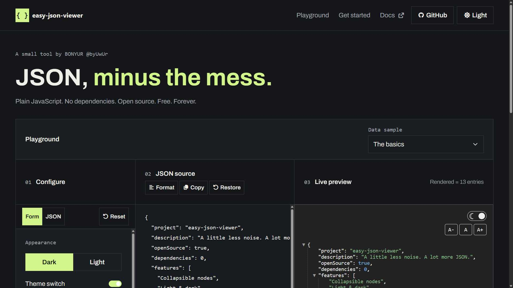

# byuwur/easy-json-viewer



Render JSON with collapsible nodes, chunked rendering, clickable URLs, light/dark themes, and text-size controls. Plain JavaScript; no dependencies or build step.

Try [GitHub Pages](https://byuwur.github.io/easy-json-viewer/) or [CodePen](https://codepen.io/byuwur/pen/ExBeOPR).

## Installation

```html
<link href="https://cdn.jsdelivr.net/gh/byuwur/easy-json-viewer@v2.10/json.min.css" rel="stylesheet" />
<link id="byVIEWtheme" href="https://cdn.jsdelivr.net/gh/byuwur/easy-json-viewer@v2.10/json.light.css" rel="stylesheet" />
<script src="https://cdn.jsdelivr.net/gh/byuwur/easy-json-viewer@v2.10/json.min.js" defer></script>
```

For local use, save `json.js`, `json.css`, and `json.light.css` beside your HTML and use those paths. Omit the CDN version only when testing development changes; pinned URLs need a new release to receive fixes.

## Usage

After the installation above:

```html
<pre id="byJSONrenderer"></pre>
<script>
  document.addEventListener("DOMContentLoaded", () => {
    const data = { name: "John Dough", projects: ["easy-json-viewer"], active: true };
    byJSONviewer(document.getElementById("byJSONrenderer"), data, { collapsed: true });
  });
</script>
```

The target and library must exist before calling the viewer; `DOMContentLoaded` waits for the deferred library.

Pass a JavaScript value: object, array, string, number, boolean, `null`, `bigint`, or a compatible big-number object. Parse JSON text with `JSON.parse()` first.

The landing page's **Copy HTML** and **Download HTML** use its displayed starter and default settings, independently of the playground. CDN/local tabs also control those exports; CDN files need internet, local files must stay beside the saved HTML.

## Options

Pass options as the third argument:

| Option             | Default | Meaning                                                                     |
| ------------------ | ------- | --------------------------------------------------------------------------- |
| `collapsed`        | `false` | Collapse nodes initially.                                                   |
| `rootCollapsible`  | `true`  | Allow the root object/array to collapse.                                    |
| `withQuotes`       | `true`  | Quote object keys.                                                          |
| `withLinks`        | `true`  | Link `http`, `https`, `ftp`, and `ftps` URLs.                               |
| `bigNumbers`       | `false` | Use compatible big-number objects' string representation.                   |
| `forceMonospace`   | `false` | Force a system monospace font when the target is not a `<pre>`.             |
| `chunkSize`        | `1000`  | Elements per chunk; invalid/nonpositive values use the default.             |
| `chunkLatency`     | `25`    | Milliseconds between chunks; invalid/negative values use the default.       |
| `themeToggle`      | `true`  | Show a theme toggle.                                                        |
| `fontSizeControls` | `true`  | Show A-/A+ controls.                                                        |
| `copyButton`       | `true`  | Show a button to copy the complete JSON, including collapsed/pending nodes. |

`<pre>` elements use a monospace font by default. Enable `forceMonospace` if you use another element, such as `<div>`, as your `.byJSONdocument`.

Smaller chunks improve responsiveness; lower latency starts the next chunk sooner. Re-rendering a target cancels its pending chunks.

Copy uses two-space-indented JSON. BigInt and compatible big-number values are copied as decimal strings to preserve precision. Copy requires browser clipboard access in a secure context; the button reports failure if access is unavailable or denied.

Each viewer shows a semi-transparent GitHub link, version, and author portfolio link at the top right. Read the library version with `byJSONviewer.VERSION`.

Controls wrap above the content on narrow viewers.

## Themes

The toggle uses a compatible `#byVIEWtheme` or finds a stylesheet named `json.light.css`/`json.dark.css`, preserving its path, query, and hash. Theme changes apply to all JSON viewers using that stylesheet. Switch that stylesheet manually to select a theme.

A-/A+ adjust only this viewer by `0.125rem`, within `0.5rem`–`3rem`. Size survives re-rendering and works without a theme stylesheet.

## Checks

[GitHub Actions](.github/workflows/rendering.yml) runs `tests/rendering.cjs` against local `json.js` in Chromium, covering values, escaping, links, controls, chunk ordering/cancellation, `test.json`, and playground exports.

## License

MIT (c) Andres Trujillo [Mateus] byUwUr
