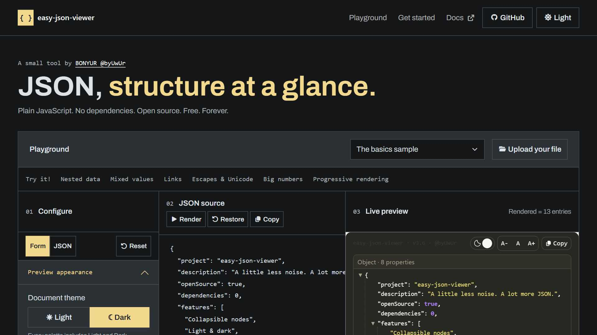

# JSON.view

Turn JavaScript values into a collapsible tree.



## Index

1. [Quick start](#quick-start)
2. [Try it](#try-it)
3. [Downloads](#downloads)
4. [API and options](#api-and-options)
5. [Themes](#themes)
6. [Checks and releases](#checks-and-releases)
7. [Related projects](#related-projects)
8. [License](#license)

## Quick start

```html
<link href="https://cdn.jsdelivr.net/gh/byuwur/json.view@latest/json.min.css" rel="stylesheet" />
<script src="https://cdn.jsdelivr.net/gh/byuwur/json.view@latest/json.min.js" defer></script>

<pre id="byJSONrenderer" data-theme="light"></pre>
<script>
  document.addEventListener("DOMContentLoaded", () => {
    const data = { name: "John Dough", projects: ["JSON.view"], active: true };
    byJSONviewer(document.getElementById("byJSONrenderer"), data, { collapsed: true });
  });
</script>
```

Pin a published tag in place of `@latest` for a fixed version.

### Offline use and Content Security Policy

The renderer loads no remote scripts, fonts, or styles. Local library files work without a CDN, including in a `file://` host. Host optional `json.themes.css` locally for extra palettes. The online playground and exported CDN starter still require internet access; a local starter requires all referenced files beside it. Playground fetches and clipboard permissions remain subject to browser restrictions.

Allow the script and style origins in your CSP. Authorize inline initialization and custom theme CSS separately, or move them into local files. The controls use static HTML templates and do not support enforced Trusted Types.

## Try it

[Playground](https://json.byuwur.co/) · [CodePen](https://codepen.io/byuwur/pen/ExBeOPR)

The library contains no tracking. The [privacy policy](https://byuwur.co/privacy/dotview) and [cookie policy](https://byuwur.co/cookies/dotview) apply only to the hosted landing page and playground.

Open [index.html](index.html) locally. Its host assets use the network. Exported starters use the default settings.

## Downloads

[ZIP](https://github.com/byuwur/json.view/releases/latest/download/json.view.zip) · [Minified ZIP](https://github.com/byuwur/json.view/releases/latest/download/json.view.minified.zip)

## API and options

Pass a JavaScript value: object, array, string, number, boolean, `null`, `bigint`, or a compatible big-number object. Parse JSON text with `JSON.parse()` first.

`byJSONviewer(element, value, options?)` replaces the target's contents and returns `undefined`. An invalid target throws `TypeError`. It has no `ready` promise or `destroy()` controller; rendering another value on the same target cancels its pending chunks.

Use acyclic, JSON-shaped data. Only own enumerable object properties are shown; functions, symbols, and `undefined` display as `null`. Non-finite numbers also display as `null`. Dates, Maps, Sets, and custom class instances have no special rendering support. Keep the supplied value stable while its chunks render; the viewer does not clone it.

Non-empty collections use named native buttons with `aria-expanded`. Tab moves between visible controls; Enter and Space toggle a collection. The collapsed item count also expands it and returns focus to the disclosure button. `collapsible: false` keeps collections expanded without disclosure controls.

### Options

Pass options as the third argument:

| Option             | Default     | Meaning                                                                                                                             |
| ------------------ | ----------- | ----------------------------------------------------------------------------------------------------------------------------------- |
| `collapsible`      | `true`      | Show disclosure controls; false keeps every node expanded.                                                                          |
| `collapsed`        | `false`     | Collapse nodes initially.                                                                                                           |
| `rootCollapsible`  | `true`      | Allow the root object/array to collapse.                                                                                            |
| `withQuotes`       | `true`      | Quote object keys.                                                                                                                  |
| `withLinks`        | `true`      | Link `http`, `https`, `ftp`, and `ftps` URLs.                                                                                       |
| `bigNumbers`       | `false`     | Use compatible big-number objects' string representation.                                                                           |
| `forceMonospace`   | `false`     | Force a system monospace font when the target is not a `<pre>`.                                                                     |
| `chunkSize`        | `1000`      | Elements per chunk; invalid/nonpositive values use the default.                                                                     |
| `chunkLatency`     | `25`        | Milliseconds between chunks; invalid/negative values use the default.                                                               |
| `animations`       | `true`      | Brief control/disclosure motion and background fades; overrides the system motion preference.                                       |
| `appearAnimation`  | `false`     | Fade the viewer in on each render when `animations` is enabled. Initial rendering remains immediate by default.                     |
| `toolbar`          | `true`      | Show the viewer header; secondary tools are configured separately.                                                                  |
| `displayContainer` | `true`      | Show the content panel frame and inner horizontal padding. `false` also hides status information.                                   |
| `statusBar`        | `true`      | Show the root type and number of items or properties. Requires `displayContainer: true`.                                            |
| `credits`          | `true`      | Show attribution in the header.                                                                                                     |
| `theme`            | Container   | Initial `"light"` or `"dark"` mode class.                                                                                           |
| `palette`          | Container   | Initial `data-theme` palette, including custom CSS names.                                                                           |
| `fontSize`         | Container   | Number in rem or a CSS size such as `"1.25em"` or `"20px"`; bounded to `0.5rem`-`3rem`.                                             |
| `themeToggle`      | `true`      | Show the theme toggle.                                                                                                              |
| `fontSizeControls` | `true`      | Show text-size controls.                                                                                                            |
| `copyButton`       | `true`      | Show a button to copy the complete JSON, including collapsed/pending nodes.                                                         |
| `controlsSize`     | `"regular"` | `"xs"` (0.5rem), `"small"` (0.7rem), `"regular"` (0.875rem), `"large"` (1rem), or `"xl"` (1.25rem); invalid values use `"regular"`. |
| `controlsCompact`  | `true`      | Keep credits beside controls; `false` stacks them. Wraps as needed.                                                                 |
| `controlsPosition` | `"top"`     | Sticky `"top"` or `"bottom"` toolbar; invalid values use `"top"`.                                                                   |

Smaller chunks improve responsiveness; lower latency starts the next chunk sooner. Re-rendering a target cancels its pending chunks.

Chunking spreads DOM creation across timers; it does not virtualize or limit the input. Collapsed descendants still render. Bound payload size and depth in the calling application.

Copy serializes the supplied value as two-space-indented JSON, independently of which chunks are visible. Unsupported values follow `JSON.stringify()` semantics and can differ from the displayed `null` fallback. BigInt and compatible big-number values become decimal strings to preserve precision. Copy requires clipboard permission in a secure context.

Read the library version with `byJSONviewer.VERSION`.

Controls stick to the selected edge of the page or nearest scrolling container.

The playground disables header-only settings while Viewer header is off, preserving their values. Appearing animation is disabled while Animations is off.

Use `toolbar: false` to hide the header, or disable `credits`, `themeToggle`, `fontSizeControls`, and `copyButton` individually.

Controls use monospace by default; override `--by-view-controls-font` to change it.

## Themes

Use `theme` for light or dark mode and `palette` for the color scheme. Monokai, GitHub, Solarized and High Contrast are built in. Load [json.themes.css](json.themes.css) after the base stylesheet for the other palettes.

Options override container settings. Omit an option or pass `null` to keep its current value. Numeric `fontSize` uses rem. CSS sizes such as `20px` also work within the `0.5rem` to `3rem` range. Invalid appearance values throw `RangeError` before replacing the document.

```html
<div id="viewer" class="dark" data-theme="github"></div>
```

Use **Copy CSS** in the playground to export appearance settings. Set `--by-view-document-bg` for the outer background and `--by-view-container-bg` for panels and controls. Define custom palette variables on the component’s mode class and `[data-theme]` selector. For example:

```css
.byJSONdocument.dark[data-theme="my-ocean"] {
  --by-view-bg: #102a43;
  --by-view-text: #f0f6fc;
}
```

### Palette names

`monokai`, `github`, `solarized`, `high-contrast`, `dracula`, `darcula`, `nord`, `catppuccin`, `catppuccin-frappe`, `catppuccin-macchiato`, `rose-pine`, `rose-pine-moon`, `gruvbox`, `gruvbox-material`, `tokyo-night`, `tokyo-storm`, `tokyo-moon`, `one`, `material`, `material-ocean`, `night-owl`, `synthwave`, `ayu`, `everforest`, `kanagawa`, `selenized`, `vscode`, `monokai-dimmed`, `discord`, `slack`, `bonyur`, `sakura`, `bubblegum`, `candy`, `rose-gold`, `lavender`, `cyberpunk`, `sunset`, `volcano`, `amber`, `terminal`, `paper`, `ink`, `ocean`, `forest`, `mint`, `ice`, `sepia`.

High Contrast text colors target at least [7:1 contrast](https://www.w3.org/WAI/WCAG22/Understanding/contrast-enhanced.html), with [3:1 contrast for control boundaries and focus cues](https://www.w3.org/WAI/WCAG22/Understanding/non-text-contrast.html). Check contrast again when you override colors.

Legacy integrations can use `#byVIEWtheme` or a detected `json.light.css` / `json.dark.css` link. The toggle keeps its path, query, and hash and updates viewers sharing the link. Explicit container themes stay independent. Separate theme files are no longer shipped; retain your hosted legacy files to use this alternative.

## Checks and releases

Use Node.js 22+ and run these commands from the repository root. For playground checks, place sibling checkouts of `spa.js` at `v20.16`, `code.view` at `v2` next to this repository.

```sh
npm --prefix .github ci --ignore-scripts --no-audit --no-fund
node .github/node_modules/playwright/cli.js install chromium
export NODE_PATH="$PWD/.github/node_modules"
node --test --test-concurrency=1 __tests__/rendering.cjs __tests__/playground.cjs
node .github/scripts/build.mjs --tag v0.0.0-local
npm --prefix .github run release:test
```

In PowerShell, replace the `export` line with `$env:NODE_PATH = "$PWD/.github/node_modules"`. [CI](.github/workflows/rendering.yml) runs Chromium automatically; choose Firefox or WebKit on a manual run.

The [release workflow](.github/workflows/release.yml) tests the regular and minified ZIPs. Both contain the runtime files, README and license. The build manifest records the version and source commit. The local build writes `dist/assets/` and `dist/RELEASE_NOTES.md`. Use `--offline` for local minification. Publish by pushing a version tag matching the library’s `VERSION` (for example, `v2` for version 2).

## Related projects

[CODE.view](https://github.com/byuwur/code.view) · [CSV.view](https://github.com/byuwur/csv.view) · [DIFF.view](https://github.com/byuwur/diff.view) · [LOG.view](https://github.com/byuwur/log.view) · [MD.edit](https://github.com/byuwur/md.edit) · [MD.view](https://github.com/byuwur/md.view) · [XML.view](https://github.com/byuwur/xml.view) · [YAML.view](https://github.com/byuwur/yaml.view)

## License

[MIT](LICENSE.md) (c) Andres Trujillo [Mateus] byUwUr
